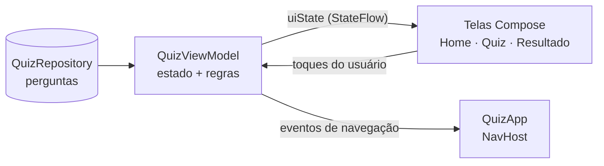

<div align="center">

# 🧠 Quizatron 3000

**Um quiz de perguntas e respostas para Android, feito com Kotlin, Jetpack Compose e arquitetura MVVM.**


</div>

---

## 📖 Sobre o projeto

O **Quizatron 3000** é um jogo de quiz criado como exercício da disciplina de
**Programação para Dispositivos Mobile**. O jogador informa o nome, responde a uma
sequência de perguntas de múltipla escolha e, no final, vê quantas acertou.

O foco do projeto é praticar o padrão **MVVM** (Model, View, ViewModel): as telas só
desenham o estado, e toda a regra do jogo fica no ViewModel.

## ✨ Funcionalidades

- 🏠 **Tela inicial** com logo animado e campo para o nome do jogador
- ❓ **Tela de quiz** com 10 perguntas, barra de progresso e contador de acertos
- 🎨 **Feedback de cor** ao responder: a resposta certa fica **verde**; se o jogador errar,
  a escolhida fica **vermelha** e a certa continua em **verde**
- 🏆 **Tela de resultado** personalizada com o nome do jogador, placar animado e estrelas
- 🎉 **Confete** quando o jogador acerta todas as perguntas
- 📳 **Vibração leve** ao tocar numa resposta
- 🔄 **Jogar novamente** sem precisar digitar o nome outra vez
- 📱 Sobrevive à **rotação da tela** sem perder o progresso

## 🛠️ Tecnologias

| Tecnologia | Uso |
|---|---|
| [Kotlin](https://kotlinlang.org/) 2.0 | Linguagem do projeto |
| [Jetpack Compose](https://developer.android.com/jetpack/compose) | Interface declarativa |
| [Material 3](https://m3.material.io/) | Componentes visuais |
| [Navigation Compose](https://developer.android.com/jetpack/compose/navigation) | Navegação entre as telas |
| [ViewModel + StateFlow](https://developer.android.com/topic/libraries/architecture/viewmodel) | Estado do jogo e eventos |
| Coroutines | Pausa para mostrar o feedback de cor antes de trocar de pergunta |

Versões principais: Android Gradle Plugin 8.7.3 · Gradle 8.9 · Compose BOM 2024.10.01 ·
`minSdk` 26 · `targetSdk` 35.

## 🏗️ Arquitetura (MVVM)



- **Model** (`data/`): a classe `Question` e o `QuizRepository`, que fornece as perguntas.
- **ViewModel** (`ui/quiz/`): guarda o `QuizUiState`, calcula a pontuação, controla o tempo
  do feedback e avisa quando é hora de navegar. Não conhece Compose nem `Context`.
- **View** (`ui/home`, `ui/quiz`, `ui/result`): funções `@Composable` sem regra de negócio.
  Recebem o estado e chamam funções do ViewModel quando o usuário toca em algo.

As três telas compartilham **uma única instância** do ViewModel, criada em `QuizApp.kt`.

## 📂 Estrutura de pastas

```text
app/src/main/java/com/example/quizatron/
├── MainActivity.kt
├── data/
│   ├── model/Question.kt
│   └── repository/QuizRepository.kt
└── ui/
    ├── components/        # Logo, botões, fundo de bolhas e confete
    ├── home/              # HomeScreen
    ├── navigation/        # QuizApp (NavHost e transições)
    ├── quiz/              # QuizScreen, QuizViewModel, QuizUiState
    ├── result/            # ResultScreen
    └── theme/             # Cores e tema
```

## 🚀 Como rodar

**Requisitos:** Android Studio Ladybug (2024.2) ou mais novo, com o JDK 17 que já vem nele.

1. Clone ou extraia o projeto.
2. No Android Studio, vá em **File > Open** e escolha a pasta `QuizatronApp`
   (a que contém o `settings.gradle.kts`).
3. Espere o **Gradle Sync** terminar. Na primeira vez ele baixa as dependências, então
   precisa de internet. Se pedir o **Android SDK 35**, aceite.
4. Escolha um emulador ou um celular com depuração USB e clique em **Run ▶️**.

> Se o Android Studio sugerir atualizar o Android Gradle Plugin, pode aceitar.

## ➕ Como adicionar perguntas

Abra `data/repository/QuizRepository.kt` e inclua mais um item na lista:

```kotlin
Question(
    text = "Qual é o maior mamífero do mundo?",
    options = listOf("Elefante", "Baleia-azul", "Girafa", "Hipopótamo"),
    correctIndex = 1, // posição da resposta certa em options (começa em 0)
),
```

O restante do app se ajusta sozinho: a barra de progresso, o "Pergunta X de Y" e o
placar usam o total de perguntas da lista.

## 🎯 Desafios do exercício

- [x] **Desafio 2:** pedir o nome do jogador antes de começar e exibi-lo na mensagem de
  parabenização do resultado.
- [x] **Desafio 3:** trocar a cor da resposta antes de mudar de tela, em verde para a
  resposta correta e em vermelho para a incorreta, destacando a certa em verde.

## 👤 Autor

Feito por **_seu nome aqui_** para a disciplina de Programação para Dispositivos Mobile.
